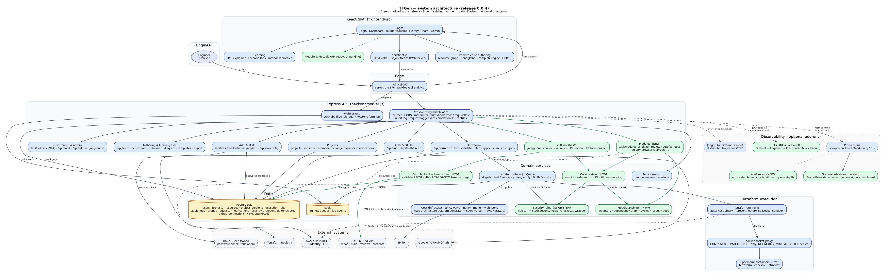

# TFGen architecture — release 0.0.4

Diagrams are generated from sources in `docs/architecture/` with Graphviz. Regenerate them with:

```
dot -Tsvg docs/architecture/architecture.dot -o docs/architecture/architecture.svg
dot -Tpng -Gdpi=100 docs/architecture/architecture.dot -o docs/architecture/architecture.png
```

Each node has a tooltip naming its source file. In the SVG, hover to see it.



Colour key: blue is an existing component, green was added in this release, amber is a data store, and dashed boxes are optional or external.

## Components

**Frontend** (`frontend/`). A React single-page app served by nginx. nginx proxies `/api/` and `/ws/` to the backend. The Builder (`pages/Studio.jsx`, `pages/Builder.jsx`) is the main working screen. HCL is generated in the browser by `engine/templateEngine.js`.

**Backend** (`backend/`). An Express application. `server.js` applies cross-cutting middleware in this order: metrics, then the request logger (correlation IDs), then the rate limiters, then the body parsers, then authentication and audit. Route groups are listed in the diagram.

**Domain services** (`backend/services/`):

| Service | Purpose | Added in 0.0.4 |
|---|---|---|
| `hclScan.js` | Block-aware scanner for HCL text (comments, strings, heredocs, nesting, line numbers) | Yes |
| `staticSecurityRules.js` | Security rules evaluated per resource, not per file | Rewritten |
| `checkov.js` | Runs Checkov in Docker when available; otherwise delegates to the static rules | Wrapper only |
| `moduleAnalyzer.js` | Module inventory, dependency graph, cycles, issues, Markdown and Mermaid output | Yes |
| `codeReview.js` | Verdict, auto-fix, pull-request diff mapping | Yes |
| `githubClient.js` | GitHub REST client: validated inputs, timeouts, rate limits, token scrubbing | Yes |
| `githubStore.js` | Per-user GitHub token, encrypted with the same AES-256-GCM helper as AWS credentials | Yes |
| `applyApproval.js` | Opt-in approval gate for `terraform apply` | Yes |
| `terraformJobs.js`, `jobQueue.js` | Dispatch of fmt, validate, plan and apply; BullMQ queue with a synchronous fallback | No |
| `terraformLsp.js` | Language-server sessions over WebSocket | No |

**Terraform execution** (`backend/terraform/runner.js`). The runner's mode is `auto` by default: it uses a host `terraform` binary if one exists, and otherwise a Docker container through `docker-socket-proxy`. The backend image includes a Terraform binary, so in the default container deployment plan and apply run inside the backend container, not in a sandbox. For production, set the mode to `docker`.

**Data.** PostgreSQL holds projects, resources, versions, execution jobs, audit logs, change requests, notifications, encrypted AWS credentials and, new in this release, encrypted GitHub tokens. Redis backs the BullMQ queues and job events.

## Key flows

Three flows are drawn in detail, each with its error paths:

- [`flow-terraform-job.svg`](architecture/flow-terraform-job.svg): from the Builder's request through authentication, rate limits, project access, input checks, credentials, the queue, the runner, the Checkov gate and the result.
- [`flow-github-review.svg`](architecture/flow-github-review.svg): connecting a token, reviewing a pull request in dry-run or post mode, and opening a pull request from a project.
- [`flow-observability.svg`](architecture/flow-observability.svg): metrics to Prometheus and Grafana, traces to Jaeger, and JSON logs through Filebeat and Logstash to Elasticsearch and Kibana.

### Apply approval (opt-in)

With `APPLY_REQUIRES_APPROVAL=true`, apply is refused unless the request carries `change_request_id` and that change request:

1. belongs to the same project,
2. is `approved` or `merged`,
3. was approved by someone other than the user applying,
4. was approved for exactly this HCL (SHA-256 of the submitted HCL equals SHA-256 of the reviewed version).

The check runs before credentials are read, so a refused apply never touches stored AWS credentials. The Builder does not yet send `change_request_id`, so enabling the gate currently blocks apply from the UI until that is added.

## Security boundaries

- **Authentication and roles.** Every mutating route is behind `authMiddleware`. Project access is checked by `authoriseProject` against membership roles.
- **Secrets at rest.** AWS secret keys and GitHub tokens are encrypted with AES-256-GCM, keyed from `ENCRYPT_KEY`. Neither is ever returned by an API. The audit log redacts body fields whose names contain password, secret, token, access or API keys, private keys, credentials, or HCL content.
- **GitHub.** The base URL comes from configuration only, so the client cannot be pointed at other hosts. Owner, repository, branch and path inputs are validated before they reach a URL. Tokens are scrubbed from error messages. Reviews are dry-run unless the request explicitly sets `post: true`.
- **Internal endpoints.** Metrics are served on an internal port (`METRICS_PORT`, default 9464) that is not published by Compose and not proxied by nginx.
- **Caller errors.** Malformed JSON, oversized bodies and disallowed origins return 400, 413 and 403 with a correlation ID and no parser detail.

## Observability

Metrics and logs are always on. Tracing is enabled with `OTEL_ENABLED=true`.

- Metrics: `prom-client` exposes HTTP latency and counts by route pattern (never raw URLs, so cardinality stays bounded), Terraform job outcomes and durations, queue depth, WebSocket connections, and Node process metrics.
- Logs: winston writes one JSON object per line. Every request line carries `correlationId`, `path`, `statusCode`, `durationMs` and, when tracing is on, `traceId`. The same correlation ID is returned in the `X-Correlation-Id` header and in every error body.
- Dashboards and alerts: `observability/grafana/dashboards/tfgen-golden-signals.json` and `observability/prometheus-alerts.yml`. Alerts cover backend down, error ratio, p95 latency, Terraform job failure ratio, queue backlog and event-loop lag.

## Configuration added in 0.0.4

| Variable | Default | Purpose |
|---|---|---|
| `APPLY_REQUIRES_APPROVAL` | `false` | Enables the approval gate for `terraform apply` |
| `GITHUB_API_URL` | `https://api.github.com` | Override for GitHub Enterprise Server |
| `GITHUB_TIMEOUT_MS` | `15000` | Timeout for each GitHub request |

`ENCRYPT_KEY` is now also required for GitHub connections, as it already was for AWS credentials. `METRICS_PORT` and `OTEL_ENABLED` are unchanged.

## Known limitations

- Module analysis reads only the files it is given. It does not resolve remote module sources, evaluate expressions, or follow `count` and `for_each`.
- The static rules cover a curated set of AWS checks. Checkov in Docker covers far more; the static fallback is for environments without Docker.
- The ELK stack runs with Elasticsearch security disabled. It is a development configuration.
